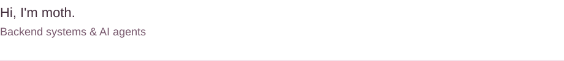

<picture>
  <source media="(prefers-color-scheme: dark) and (max-width: 600px)" srcset="assets/hello-dark-mobile.svg">
  <source media="(max-width: 600px)" srcset="assets/hello-light-mobile.svg">
  <source media="(prefers-color-scheme: dark)" srcset="assets/hello-dark.svg">
  
</picture>

Most of my recent work is on **agent runtimes, task delegation and traceable knowledge**.

`TypeScript` · `Java` · `Python` · frontend, barely.

## Selected work

- **[pi-subagent](https://github.com/mothieras/pi-subagent)** — Task delegation for Pi: separate contexts, scoped tools, parallel tasks and background execution. Derived from Pi's official subagent example.
- **[coil-core](https://github.com/mothieras/coil-core)** — A local-first coding-agent engine with MCP, concurrent subagents and replayable sessions. The core runs without a UI.
- **[agent-knowledge-base](https://github.com/mothieras/agent-knowledge-base)** — Self-hosted retrieval and shared knowledge for agents, with citations you can trace to their source. A local-deployment prototype.

Also building: [moj-code-sandbox](https://github.com/mothieras/moj-code-sandbox), a Docker-based code sandbox for Java, Python and C++.

## Open-source contribution

**[CodeIsland #361](https://github.com/wxtsky/CodeIsland/pull/361)** · Merged October 9, 2026

Enabled Codex hooks without corrupting existing TOML configuration. The fix preserves unrelated settings and formatting across local and remote installers.

What changed

- Recognize the actual feature flag rather than similarly named keys in other tables or strings.
- Preserve comments, line endings and unrelated values; reject unsupported layouts without rewriting the file.
- Exercise local and remote behavior with shared regression fixtures.

[All repositories](https://github.com/mothieras?tab=repositories) · [Pull requests](https://github.com/pulls?q=is%3Apr+author%3Amothieras+is%3Apublic)
